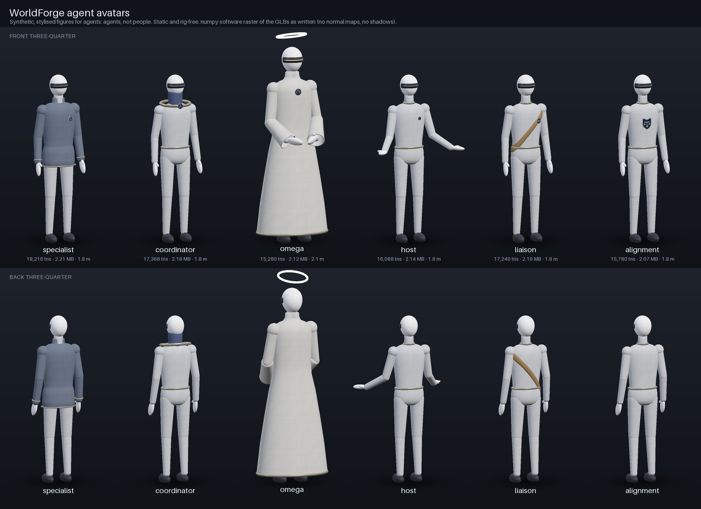

# WorldForge agent avatars

Six stylised humanoid GLBs, one for each avatar role that WorldForge cards can point at. They are rig-free
and generated procedurally with numpy and PIL. Geometry and every texture are made by
`build_avatars.py` from fixed seeds. Nothing is imported, and nothing is modelled on a real person.
**They are agents, not people.** Each root node says so in its extras (`synthetic: true`,
`note: "stylised agent avatar; an agent, not a person"`).

```bash
python3 worldforge/avatars/build_avatars.py             # write the GLBs + index.json, run the Khronos validator -> validation.json
python3 worldforge/avatars/build_avatars.py --preview   # also render preview.jpg (numpy software raster of the written GLBs)
python3 worldforge/avatars/build_avatars.py --check     # rebuild in memory; exit 1 if any output or validation.json is behind
#   success line: "avatars current: 6 roles, <N> triangles, 0 failing"   stale: "avatars STALE: ..."
# interactive viewer (static server on :8080): http://127.0.0.1:8080/worldforge/avatars/preview.html   (&hue=<0-360> tints fabric)
```



## Outputs (`worldforge/out/assets/avatars/`)

| File | What it is |
|---|---|
| `specialist.glb` `coordinator.glb` `omega.glb` `host.glb` `liaison.glb` `alignment.glb` | glTF 2.0 binary, about 2.1 MB each, 15k–18k triangles, with all textures embedded |
| `index.json` | For each role: file, bytes, triangles, vertices, bounds, materials, textures (use/width/height), sha256 |
| `validation.json` | Khronos glTF-Validator report for each GLB, keyed by sha256 (`--check` fails if it lags the GLBs) |
| `preview.jpg` | Contact sheet, front and back three-quarter views. It is a software raster, not a renderer reference |

Every role currently validates with **0 errors, 0 warnings, 0 infos and 0 hints** (gltf-validator 2.0.0-dev.3.10).

## The figure

- Height is 1.8 m to the top of the head; omega is 2.1 m, plus a floating halo up to 2.23 m. Feet sit at y = 0.
  The figure faces +Z with +Y up, in metres.
- The body is built from smooth lathe, ellipsoid and capsule parts: an egg-shaped head with a visor band
  where a face would be, neck, torso and pelvis, a collar, shoulder caps, upper and lower arms, mitt hands
  with a thumb, legs and boots. There is no face, no hair and no skin.
- Normals are smooth per vertex, welded across UV seams. Fabric parts carry UVs and per-vertex tangents
  (Lengyel's method, not exact MikkTSpace; bitangent toward decreasing v, as glTF expects).
- Role cues:

| Role | Cue |
|---|---|
| specialist | work jacket (body, sleeves, stand collar, hem and cuff trim) and a round chest badge |
| coordinator | tall collar, shoulder ring and a medallion at the front of the ring |
| omega | long robe with bell sleeves and hands held together in front, emissive visor (strength 2.5), halo ring on its own child node (`Avatar · Omega · Halo`, which a viewer may spin), robe clasp |
| host | open-hand pose (forearms forward and out, palms up) and a small chest badge |
| liaison | sash from the left shoulder to the right hip, with a clasp medallion |
| alignment | shield emblem on the chest, curved to follow it |

- Node names are `Avatar · <Role>`, all well under the 48-character fabric limit. The root extras carry
  `role`, `generator`, `synthetic`, `note`, `height_m`, `facing`, `tint_targets`, and `sockets`. The
  sockets are `voice` (in front of the visor, where a positional voice source belongs), `nameplate`, and
  `halo` for omega only. They are in metres in the avatar frame.

## Materials and textures (PBR metallic-roughness)

| Material | Textures |
|---|---|
| `AV_Fabric_Body`, `AV_Fabric_Garment` | 2048² baseColor: plain weave, neutral light grey (JPEG q88). 2048² normal: weave, plus seam grooves with running stitches on the tile edges where the lathe UV seams fall (JPEG q90). 1024² ORM: R occlusion, G roughness, B metallic (JPEG). Fabric tiles every 0.5 m, with an integer number of tiles around each body so seams line up. |
| `AV_Visor` | 1024² glossy dark-glass baseColor plus a 1024² emissive light bar. Roughness 0.07. Omega also uses `KHR_materials_emissive_strength`, which the validator accepts. |
| `AV_Emblem` | 1024² PNG for each role: an abstract geometric mark (hexagon node, linked triangle, open rings, cupped arc, overlapping circles, balance on a shield). No text and no real logos. |
| `AV_Shell` (head, hands), `AV_Trim` (rings, belt, cuffs), `AV_Boot`, `AV_Halo` | Untextured factors. `AV_Halo` is emissive with strength 3. |

**Per-world tint.** Fabric textures are neutral grey, so a viewer tints an avatar by multiplying the
`baseColorFactor` of the `AV_Fabric_Body` and `AV_Fabric_Garment` materials by a colour derived from the
world's brand hue (`worlds/generated/teams/<slug>.json` `.brand.hue`). `preview.html?hue=121` shows this.

## Checks run by every build

These run for each role: the triangle count is between 6,000 and 20,000; the feet are at y = 0; the
figure top is within 3 cm of 1.8 m (or 2.1 m for omega); the visor is on the +Z side; node names are 48
characters or fewer and start with `Avatar · `; the root extras are present with `synthetic: true`; the
file is under 4 MB; texture sizes are as specified; and the Khronos validator reports 0 errors and 0
warnings for the current bytes. Outputs are deterministic, with fixed seeds and no timestamps, so
`--check` compares them byte for byte.

## Not done yet

- **No rig, skin weights, animation, blend shapes or lip-sync.** The avatars are static. Voice is
  "connected" only to the extent that the `voice` socket marks where a viewer should attach a
  positional audio source. Voiced lines come from the hive (`agents/hive/voices/...`), not from here.
- **Cards use only two of the six files so far.** `worldforge/build.mjs` points every agent card at
  `specialist.glb` (242 cards) and every Omega card at `omega.glb` (41 cards). Another builder's
  `worldforge/viewer.html` and `worldforge/avatars.mjs` also place `coordinator.glb` for each world's swarm
  coordinator. Nothing references host, liaison or alignment yet: assigning them needs a registry field
  that names an agent's avatar role, and without one the assignment would be invented. (That builder's
  registry index is `worldforge/out/avatars/index.json`; the GLB index here is a different file, schema
  `worldforge-avatar-glbs/0.1`.)
- `preview.jpg` comes from the numpy raster: no normal maps, no shadows, and fabric sampled at a coarse
  mip. `preview.html` renders the real PBR materials through three.js, but it loads three@0.160.0 from
  jsDelivr. During this build that CDN reset connections, so the headless-Chrome path
  (`--preview-chrome`) could not produce a screenshot here.
- These avatars have not been loaded in the Sneeze native host. As for the worlds, that gate stays open
  until Sneeze is checked out.
