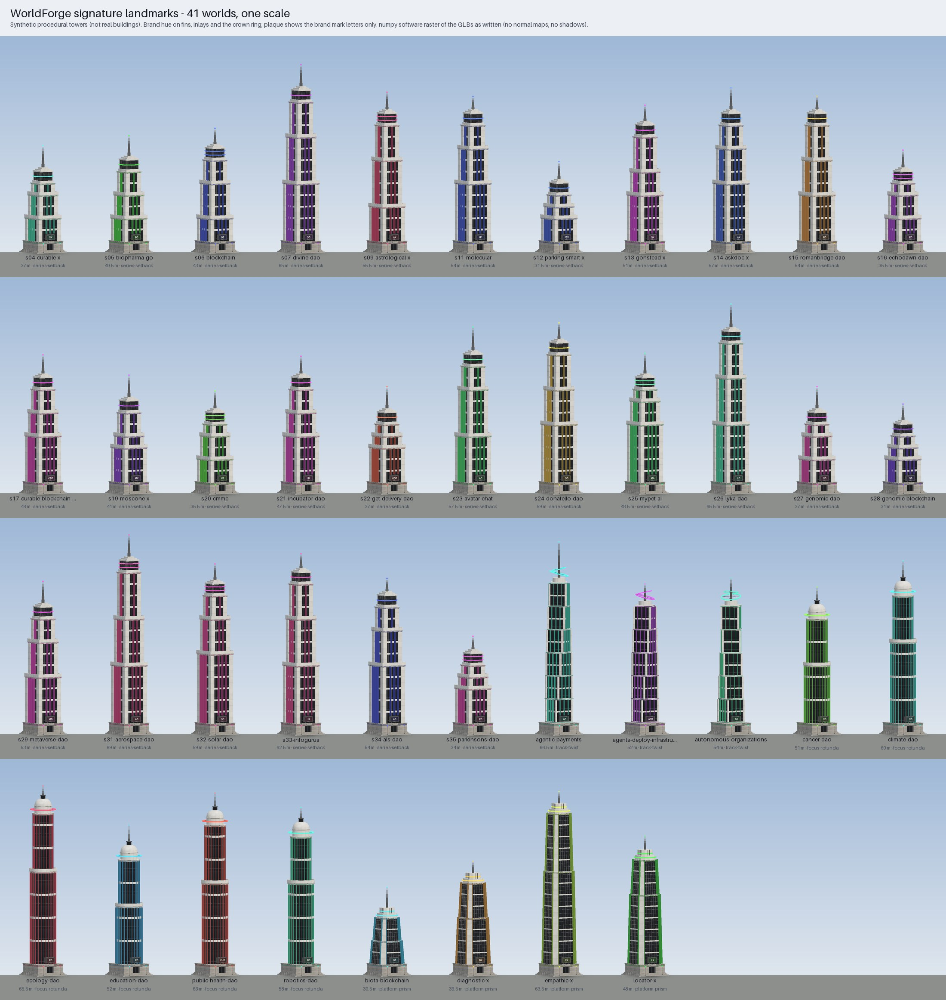

# WorldForge signature landmarks

One procedural civic tower per world (41 GLBs). Each gives its world a skyline you can recognise from the plaza.
`build_landmarks.py` writes the geometry and every texture from scratch with numpy and PIL. Nothing is imported, and
nothing is modelled on a real building. **These are synthetic.** The root node of every GLB says so in its extras
(`synthetic: true`, `note: "synthetic procedural civic landmark; not a real building and not modelled on one"`).

```bash
python3 worldforge/landmarks/build_landmarks.py               # write 41 GLBs + index.json, run the Khronos validator ->
                                                              #   validation.json, render preview.jpg + preview.json
python3 worldforge/landmarks/build_landmarks.py --no-preview  # same, without re-rendering the contact sheet
python3 worldforge/landmarks/build_landmarks.py --check       # rebuild in memory; exit 1 if any output, validation.json
                                                              #   or the preview stamp lags, or any eval fails
#   success line: "landmarks current: 41 worlds, <N> triangles, 0 failing"   stale: "landmarks STALE: ..."
```



## Outputs (`worldforge/out/assets/landmarks/`)

| File | What it is |
|---|---|
| `<slug>.glb` x 41 | glTF 2.0 binary with all textures embedded (self-contained). See index.json for size and triangle count |
| `index.json` | `worlds[]`: slug, file, bytes, triangles, vertices, height_m, style, hue, mark, plaque_text, bounds, materials, textures, sha256, `placement`. Also `totals`, `styles`, `universal_placement` and the rules |
| `validation.json` | Khronos glTF-Validator report per GLB, keyed by sha256. `--check` fails if it lags the GLBs or shows any error or warning |
| `preview.jpg` / `preview.json` | Contact sheet of all 41 towers at one scale (numpy software raster of the GLBs as written: no normal maps, no shadows). The stamp holds the GLB digest it was rendered from |

## Inputs (read only)

- `my-fabric/worlds/index.json`: which worlds exist, plus the fields the style family is derived from.
- `worlds/generated/teams/<slug>.json` `.brand`: `hue` sets the tint and glow colours. `mark` supplies the plaque letters.
- `worldforge/out/<slug>/blockout.generated.json` and `cards.json`: used only to compute a placement suggestion that is
  clear of everything already in that world. The GLBs do not depend on them.

## The tower

All sizes are in metres. Origin is at the base centre, +Y is up, and the **entrance faces +Z**. The footprint is
exactly 12 x 12. Height runs from 30 to 70: `30 + 40*u`, where `u` comes from `sha256("landmark:height:<slug>")`,
rounded to 0.5 m. The height has no meaning beyond making the skyline vary.

- **Plinth, 0 to 4 m (stone):** three steps all round, then the body with a moulded cornice. The +Z front has a
  recessed portal with a glazed door in a metal frame, a canopy on hangers and a tinted inlay band. Two lamp
  standards flank the steps.
- **Emblem plaque:** 3.2 x 1.6 m, set in a projecting metal frame on the shaft base above the portal, facing +Z,
  centred at y = 5.45. Its 1024x512 texture shows the brand mark letters in Pillow's bundled sans (Aileron). These
  letters are the only text on a landmark. There are no logos.
- **Shaft:** vertical tinted fins with rounded noses, slim metal mullions and transoms, spandrel bands at the floor
  lines (every 4 m) and setbacks. The form depends on the style family (below).
- **Crown:** an emissive ring in the brand hue, then a spire, finial or mast. The top of its glowing bead is at
  exactly `height_m`.

### Style families (derived from `my-fabric/worlds/index.json`, never invented)

| Style | Rule (first match wins) | Count | Form |
|---|---|---|---|
| `series-setback` | `name` ends in `(Series N)` | 28 | Square shaft, 9.0 / 7.5 / 6.0 m tiers with parapets, corner piers, blade fins between glass bays, louvred lantern, emissive ring (two rings on one hash variant), stepped cap, needle spire |
| `track-twist` | a `zones[].source` cites `worlds/sources/founder-tracks-2026-09-28.md` | 3 | Two-floor glass modules that each turn 6-10 degrees (direction and amount from the slug hash) and taper slightly, with floor plates and tinted inlays, a pod, a mast and two tilted emissive rings |
| `focus-rotunda` | `name` ends in ` DAO` and a `zones[].source` cites the PBC mission statement | 6 | Round drum with one setback, radial fins, limestone bands, a drum with a floating emissive ring on eight struts, a dome and a glazed oculus lantern |
| `platform-prism` | none of the above (worlds whose zones cite their own source documents) | 4 | Chamfered octagonal prism with a batter and one setback, tinted edge fins, glass main faces with sunshade blades, an octagonal cap with a floating emissive ring, a ribbed upper stage and a mast |

### Materials and textures (PBR, metallic-roughness)

| Material | Textures | Notes |
|---|---|---|
| `LM_Facade` | baseColor, normal and ORM, each 2048x2048 (JPEG) | Neutral light panels, so the tower reads in daylight. The normal map carries panel seams and bevels. The panel pattern differs per style family (grid, staggered ashlar, tall brushed panels, banded). One set per style is shared byte for byte by every GLB of that style |
| `LM_Glass` | baseColor, normal and ORM, 1024 (JPEG) | Dark curtain wall with framed panes and a transom line. Roughness is about 0.06 on the glass, metallicFactor 0.6. Shared by all |
| `LM_Stone` | baseColor, normal and ORM, 1024 (JPEG) | Granite ashlar for the plinth. Shared by all |
| `LM_Fin_Tint` | none | Brand hue: `hsl(hue, 0.50, 0.48)`, metallic 0.7, roughness 0.34. Used on fins and inlays |
| `LM_Crown_Glow` | none | Brand hue: `hsl(hue, 0.95, 0.58)` normalised, with `KHR_materials_emissive_strength` 5. Used on the crown ring and bead |
| `LM_Metal` | none | Graphite bronze. Used on frames, mullions, louvres, struts and the spire |
| `LM_Plaque` | 1024x512 (PNG) | The only per-world texture: the mark letters on a deep field in the brand hue |

Every GLB is self-contained, so the shared textures are embedded again in each file. The per-world bytes are the
geometry, the plaque and the colour factors. Textured primitives carry UVs and tangents (Lengyel's method, like
the avatars), and the UVs are in world metres, so panel seams line up with the 1.5 m bays and the 4 m floors.

## Placement for the lead (suggested; `worldforge/build.mjs` is not edited here)

`index.json` lists a placement for each world, `worlds[i].placement = {translation: [x, 0, z], yaw_deg, clearance_m}`.
Apply it as a node translation plus a rotation of `yaw_deg` about +Y. The yaw turns the +Z entrance toward the plaza
centre. The search works like this:

- Candidates sit north of the plaza (the council side, -Z), between the plaza and the council road. The centre is
  7-18 m east or west of the road axis, so the council road and the sight line from the plaza to the council stay
  open.
- The footprint stays at least 1 m off the 48 x 48 plaza pad.
- The footprint keeps at least 3 m from every blockout primitive, every road (allowing for its width) and every card
  volume in that world.
- The nearest candidate to the plaza wins. Ties go to the east side.

Primitives, roads and cards whose id or kind contains `landmark` are skipped, so the landmark the lead adds later
cannot push the placement around. `universal_placement` is one spot that is clear in all 41 current worlds, for use
if a single constant is preferred. Placements are recomputed from the blockout on every build, so `--check` goes
stale if the world layout changes. That is intended.

## Evals (per world; `--check` exits 1 if any fails)

The checks are:

- `height_in_range`, `height_from_hash` and `top_at_height` (top of bounds = height_m within 1 cm).
- `origin_base_centre`, `footprint_12m` and `entrance_plus_z` (the door and plaque sit at z > 4 and the plaque normal
  is +Z).
- `triangles_in_range` (8k-60k), `under_3_5mb` and `names_fit` (48 characters or fewer).
- `extras` (world, height_m, style, generator and `synthetic: true`).
- `textures` (facade 2048 x3, glass and stone 1024, plaque 1024x512).
- `brand_hue` (fin and glow colours within 1.5 degrees of `brand.hue`) and `plaque_text`.
- `style_derived` and `placement_clear`.

On top of these, Khronos validation must show 0 errors and 0 warnings, against the current sha256 of each GLB.

## What this is not (yet)

- **Not placed in the worlds.** Nothing in `worldforge/build.mjs`, the cards or the viewer references these GLBs
  yet. The placement above is a suggestion for the lead.
- **Exterior only.** There is no interior, no LODs, no collision mesh and no animation. The portal is a recess with
  a door; it does not lead anywhere.
- **Plaque letters come from the registry as written, minus punctuation.** Some `brand.mark` values carry a stray
  `(` or a series digit from a `(Series N)` name, for example `CX(`, `B(6` and `M(1`. The plaque renders only their
  letters and digits (`CX`, `B6`, `M1`). Several worlds share a mark (`CD`: Cancer DAO and Climate DAO; `ED`, `AX`,
  `DD`, `AD`), and only the hue tells them apart. Fixing the marks belongs to the team-brand generator, not here.
- **The preview is a look, not a render reference.** It has no normal maps and no shadows, and the emissive is
  scaled down so it reads in daylight.
- **Normal maps are JPEG** (to keep each GLB small), so seams carry some block artefacts up close.
